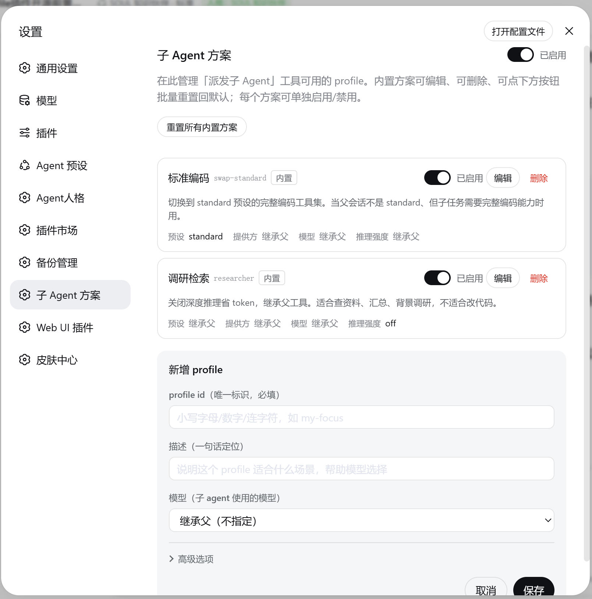
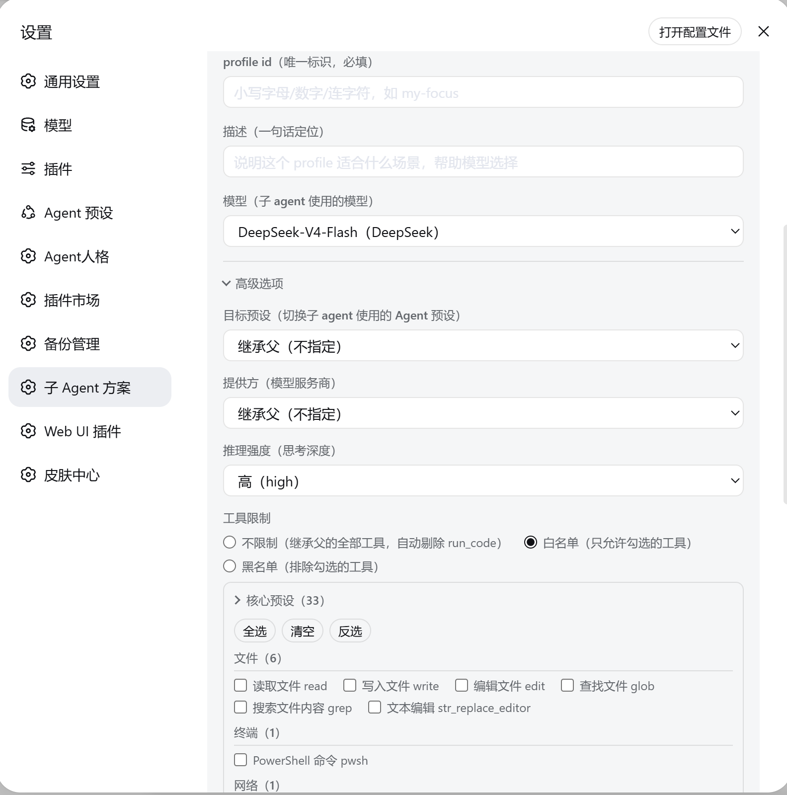
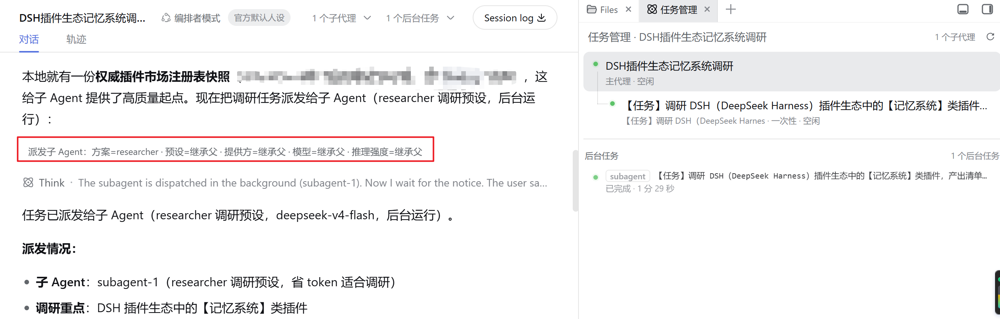

# dsh-subagent-profile

<!-- Hero -->
<div align="center">
  <b style="font-size: 1.15em;">子 Agent 派发插件 —— 派发可控 · 成本有数 · 决策留痕</b><br /><br />
  
  
  
  
</div>

<div align="center">English · <a href="README.zh.md">中文</a></div>

For [DeepSeek Harness](https://github.com/deepseek-ai/dsh) (DSH).

> Dispatch subagents in DeepSeek Harness: pick model, reasoning effort, and tool scope per task; save common combos as named profiles for reuse. Built-in safety checks, cost estimation with savings analysis, and a full decision ledger.

## Why this plugin

| | Built-in `subagent` | `dsh-subagent-profile` |
|---|---|---|
| Per-subtask model / preset | ✅ optional `provider` / `model` / `reasoning_effort` (after enabling model selection) | ✅ one profile bundles preset + model + effort + tool scope + budget; overridable per call |
| Reusable named setups | ❌ | ✅ profiles |
| Tool-scope narrowing | ❌ | ✅ whitelist ∩ parent, `run_code` always removed |
| Safety checks | ❌ | ✅ whitelist / cost / intersection / approval / budget, all recorded |
| Cost visibility | ❌ | ✅ per-dispatch estimate + savings comparison |
| Decision ledger | ❌ | ✅ full trace: request vs. effective, checks, execution, settlement |
| GUI management | ❌ | ✅ settings page + per-session ledger tab |
| Performance-based suggestions | ❌ | ✅ confirm to apply, undo anytime |
| Official model-selection interplay | ✅ enforced natively once enabled | ✅ dispatch follows the same whitelist (out-of-range routes are rejected) |
| Strategy object & explicit auto | ❌ | ✅ `strategy` object / explicit `auto` resolution (scheme → parent → default) |
| Inherited-change confirmation | ❌ | ✅ `confirm` gate: non-explicit model changes require explicit confirmation before dispatch |
| Session dispatch budget | ❌ | ✅ configurable session budget (tokens & concurrency); dispatch stops with reminder at the cap |

## Installation

```bash
dsh plugin --profile web add dsh-subagent-profile        # published package
dsh plugin --profile web add ./dsh-subagent-profile      # from a local checkout
```

Restart `dsh web`. This is a standard **bundle plugin**: it provides the `dispatch` tool, the profile provider, the `subagent-profiles` service, the `/subagent-profiles/*` loopback management routes, the settings page (「子 Agent 方案」), the per-session ledger tab, and the `dispatch` tool-call card in the web GUI. On startup it also **self-installs an agent preset** — **`orchestrator-v2`** (「编排者模式 V2」) — pick it in the new-session preset picker. The sync is idempotent and re-runs on every startup, so upgrading the plugin updates the preset.

## Usage

### 1. Configure sub-agent profiles

Profiles are managed in the settings page — each one bundles preset + model + reasoning effort + tool scope (and optionally a persona), and can be enabled, disabled, edited, or reset individually. Two built-ins ship:

| Profile | Purpose |
|---|---|
| `swap-standard` | switch the child to the full standard coding toolkit |
| `researcher` | deep reasoning off, search-only tools |

Profiles live in `~/.dsh/subagent-profiles.json` and take effect immediately (edits are made from the settings page).





### 2. Dispatch per subtask — the `dispatch` tool

```js
dispatch(
  profile: "researcher",        // preset + model + reasoning effort + tool scope
  prompt: "Survey the DSH plugin ecosystem and compare direct competitors",
  run_in_background: true
)
```



### 3. Review in the decision ledger

Every session has a ledger tab that records each dispatch decision: what the parent saw and requested, what actually took effect (with ignored-request highlights), which tools were removed and why, how execution went (including stalls and parent interventions), and what it cost. Safety-check failures are surfaced with fix directions.

## Safety model

Delegation never lets a subagent gain more power than you already have — this is the default, with no configuration:

- **Tools only shrink.** A child's tool set is the intersection of the profile's tools and the parent's tools, and `run_code` is always removed.
- **Approval is never bypassed.** Delegation does not waive the host's approval requirements; operations that need approval are rejected automatically.
- **Cost is capped.** Model, reasoning effort, tokens, and recursion depth are all bounded; out-of-range values fail loudly instead of silently downgrading.
- **An escape hatch, explicitly.** Non-official presets can be allowed per-preset (default off, each allowance audited).

## Observability & notifications

- **Live status.** Background dispatches show live phase badges (start / gate / create / running / settled), driven by host job events with polling fallback.
- **Reminder center.** Urgent events (escape-hatch allowances, audit degradation, budget anomalies) raise a persistent badge; the notification center keeps every reminder with full context — parent session, child session, task summary, and outcome — plus one-click jumps to the related sessions. Normal orchestration events (e.g. a parent not adopting a child's result) are recorded in the audit ledger without interrupting you.
- **Dispatch suggestions.** Based on historical dispatch statistics, the plugin can inject read-only optimization hints for the parent agent (e.g. "this profile has a low recent success rate, consider switching") — hints only, nothing is changed automatically.
- **Subagent header badge.** Child sessions show a compact summary badge (e.g. `继承父会话 · 前台` — "inherits the parent session, foreground"); hover for the full detail (model / effort / preset / mode / origin).

## Data

- `~/.dsh/subagent-profiles.json` — the profile registry (edited from the settings page).
- `~/.dsh/subagent-profiles.state.json` — the plugin's enable/disable switch (default enabled).
- `~/.dsh/subagent-profiles.failed-traces.json` — the failure ledger (dispatch failure traces).
- `~/.dsh/subagent-evolution/` — the decision ledger and statistics:
  - `dispatch.jsonl` — per-dispatch decision records (no prompt content).
  - `summaries.json` — aggregated per-profile statistics (versioned, rebuilt on corruption).
  - `adopted-state.json` — adoption verdict state for child results (cross-restart).
  - `reminders.json` — reminder store (one reminder = one audit record).
- `~/.dsh/.agent-presets/orchestrator-v2/` — the self-installed `orchestrator-v2` agent preset (synced from the bundled `presets/orchestrator-v2/` on every startup).

`DSH_HOME` is respected and defaults to `~/.dsh`. Uninstalling the plugin removes the data files above and the self-installed `orchestrator-v2` preset directory (other plugins' presets are left untouched); re-installing or re-launching re-syncs the preset and regenerates the data files.

## Known limitations

- **Background dispatch** requires `@deepseek-ai/dsh-jobs` and `@deepseek-ai/dsh-tool-jobs` to be loaded; otherwise it fails with "dispatch: 后台派发不可用：缺少 jobs 服务".
- **Continuable mode** goes through the DSH standard composition path, so the `preset` swap and `reasoningEffort` are ignored (the child inherits the parent preset at the default reasoning effort).
- **Continuable follow-ups** are delivered through the official `send_message` channel (the plugin drives the child via the official child handle).
- **Official model selection is a web-line feature**: the session policy for the built-in subagent tools ships with the web app and is not available in headless deployments. In production it is off by default and must be enabled before it takes effect.
- **Who decides the child's final tool set depends on the mode**:
  - Continuable: narrowed by this plugin up front — the child's `allow` = (parent tool set − `run_code` − `deny`) ∩ `allow`. Assumption: continuable inherits the parent preset, so the child's tool set ≈ the parent's; if dsh's behavior changes so the two differ (e.g. a future preset swap composing a different tool set), tool narrowing fails with a hard error (conservatively safe — never silently granting more), to be replaced with a true parent ∩ child intersection once dsh provides an official seam.
  - One-shot: decided by dsh; the plugin cannot read the final restricted result and the card reports "tools are finally granted by the system".
- **Cost figures are estimates**: computed from an average per-dispatch price (measured once per model); fine-grained per-token pricing is on the roadmap. The UI labels estimates as such and shows a note when the sample size is small.

## Repository structure

```
dsh-subagent-profile/
├── index.mjs          # plugin entry: dispatch tool, profile provider, services, HTTP routes
├── lib/
│   ├── client.js      # browser side: settings page, per-session ledger, dispatch tool-call card
│   └── core/          # host-side modules by domain: gates, ledger, evolution, profiles, query, sync
├── presets/           # bundled agent presets (e.g. orchestrator-v2)
├── test/              # node:test suite (pure and junction tiers)
└── docs/              # screenshots
```

## Contributing

Found a bug or have an idea? [Open an issue](https://github.com/muzyLink/dsh-subagent-profile/issues) or submit a pull request — all contributions are welcome.

If this plugin has been useful to you, please give it a ⭐ on GitHub — it helps others find it.

## Credits

The bundled `orchestrator-v2` agent preset was inspired by [dsh-liangshen](https://github.com/zhu1090093659/dsh-web-ui/tree/main/packages/dsh-liangshen) (梁神模式) from [dsh-web-ui](https://github.com/zhu1090093659/dsh-web-ui), licensed under Apache-2.0. Thanks to its author for the great work.

## License

[MIT](LICENSE) — Copyright (c) 2026 muzyLink
