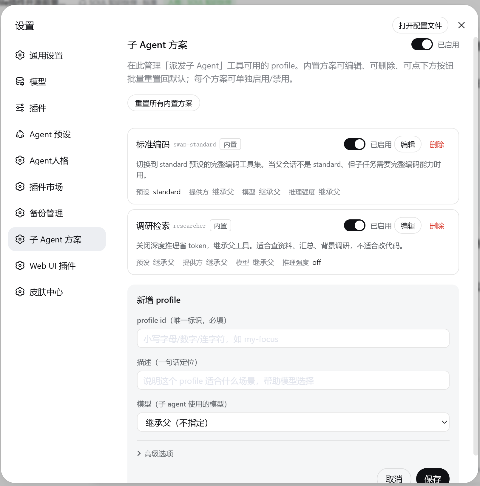
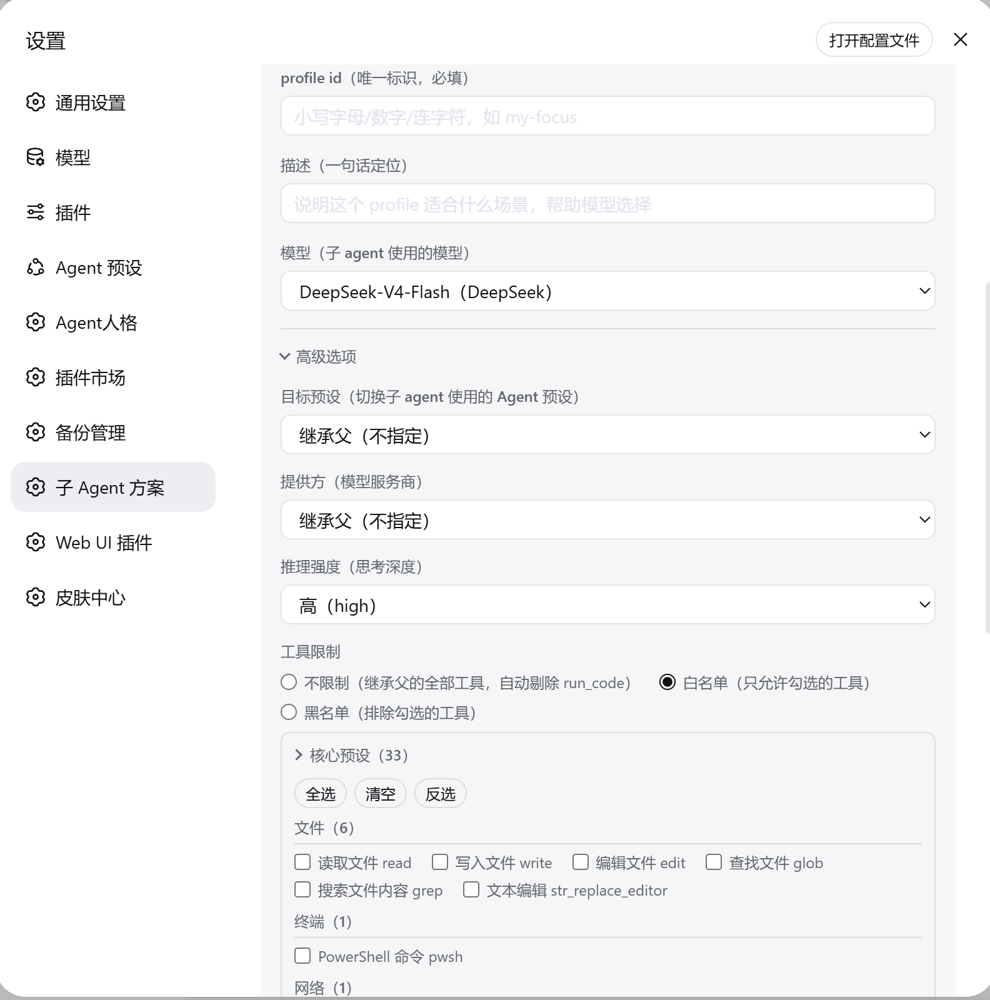
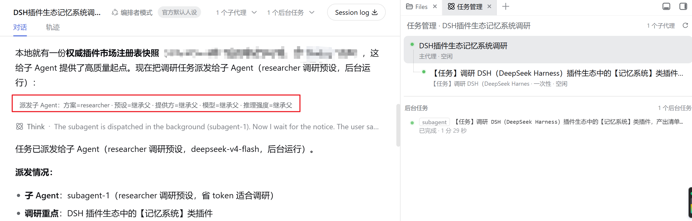

# dsh-subagent-profile

<!-- Hero -->
<div align="center">
  <b style="font-size: 1.15em;">子 Agent 派发插件 —— 派发可控 · 成本有数 · 决策留痕</b><br /><br />
  
  
  
  
</div>

<div align="center"><a href="README.md">English</a> · 中文</div>

适用于 [DeepSeek Harness](https://github.com/deepseek-ai/dsh)（DSH）。

> DeepSeek Harness 子 Agent 派发插件：按任务为子代理选模型、推理强度与工具范围，常用组合存成命名方案随时复用；内置安全检查、成本估算与节省分析、完整决策台账。

## 为什么需要这个插件

| | 内置 `subagent` | `dsh-subagent-profile` |
|---|---|---|
| 按子任务选模型/预设 | ✅ 可选 `provider` / `model` / `reasoning_effort`（需先启用模型选择） | ✅ 方案级 profile：预设+模型+推理强度+工具范围+预算一捆，per-call 可覆盖 |
| 可复用的命名方案 | ❌ | ✅ 方案（profile） |
| 工具范围收敛 | ❌ | ✅ 白名单 ∩ 父会话，`run_code` 恒移除 |
| 派发前安全检查 | ❌ | ✅ 白名单/成本/交集/审批/预算，全程记录 |
| 成本可见 | ❌ | ✅ 每次派发的成本估算 + 节省对照 |
| 派发决策台账 | ❌ | ✅ 请求 vs 生效、检查结果、执行、结算全留痕 |
| 界面管理 | ❌ | ✅ 设置页 + 会话内台账标签页 |
| 基于表现的改进建议 | ❌ | ✅ 确认后应用 · 随时撤销 |
| 官方模型选择联动 | ✅ 启用后由官方工具自身校验 | ✅ 官方启用后派发遵循同一白名单（越界路由直接拒绝） |
| 策略对象与显式自动 | ❌ | ✅ `strategy` 对象 / 显式 `auto` 解析（方案 → 父级 → 默认） |
| 继承变更确认 | ❌ | ✅ `confirm` 闸：非显式模型变更需显式确认后才放行 |
| 会话派发预算 | ❌ | ✅ 会话级预算上限（token 与并发）可配置，达到上限中止并提醒 |

## 安装

```bash
dsh plugin --profile web add dsh-subagent-profile        # 发布包
dsh plugin --profile web add ./dsh-subagent-profile      # 本地源码
```

重启 `dsh web`。这是一个标准的 **bundle 插件**：提供 `dispatch` 工具、方案提供者、`subagent-profiles` 服务、`/subagent-profiles/*` 回环管理路由、设置页（「子 Agent 方案」）、会话内派发决策台账标签页，以及 web 界面中的 `dispatch` 工具卡片。启动时还会**自动安装一个 agent 预设**——**`orchestrator-v2`**（「编排者模式 V2」）——在新会话的预设选择器里选用。同步是幂等的且每次启动重跑，升级插件即更新预设。

## 使用

### 1. 配置子 Agent 方案

方案在设置页管理——每个方案打包预设 + 模型 + 推理强度 + 工具范围（可选人设），可单独启用、禁用、编辑、重置。内置两个：

| 方案 | 用途 |
|---|---|
| `swap-standard` | 让子代理切换到完整标准编码工具集 |
| `researcher` | 关闭深度推理，仅搜索工具 |

方案数据存于 `~/.dsh/subagent-profiles.json`，设置页修改即时生效。





### 2. 按子任务派发——`dispatch` 工具

```js
dispatch(
  profile: "researcher",        // 预设 + 模型 + 推理强度 + 工具范围
  prompt: "调研 DSH 插件生态并对比直接竞品",
  run_in_background: true
)
```



### 3. 在派发决策台账中复盘

每个会话都有「派发决策台账」标签，记录每次派发决策：父会话看到了什么、请求了什么，实际生效了什么（请求被忽略处高亮），哪些工具被移除及原因，执行过程如何（含停滞与主 Agent 干预），以及成本多少。安全检查失败时给出修复方向。

## 安全模型

委派永远不会让子代理获得比你更大的权限——这是默认行为，无需配置：

- **工具只减不增。** 子代理的工具集 = 方案工具 ∩ 父会话工具，且 `run_code` 恒移除。
- **审批永不豁免。** 委派不豁免宿主的审批要求；需要审批的操作自动拒绝。
- **成本有上限。** 模型、推理强度、token、递归深度全部有界；越界值大声失败而非静默降级。
- **逃生舱，显式开启。** 非官方预设可逐个放行（默认关闭，每次放行留审计）。

## 可观测性与通知

- **实时状态。** 后台派发的阶段徽标实时更新（发起/检查/创建/执行中/结算），宿主任务事件驱动，轮询兜底。
- **提醒中心。** 紧急事件（逃生舱放行、审计降级、预算异常）触发常驻红角标；通知中心里每条提醒都带完整上下文——主会话、子会话、任务摘要、结果状态——并可一键跳转对应会话。正常编排事件（如父会话未采纳某次派发结果）只记审计台账，不打断你。
- **派发优化建议。** 基于历史派发统计，插件可向主 Agent 注入只读优化提示（如「该方案近期成功率偏低，可考虑换方案」）——只提示，不自动改任何配置。
- **子会话页头徽标。** 子会话页头显示紧凑摘要标签（如 `继承父会话 · 前台`），悬停查看全部字段（模型/推理强度/预设/模式/来源）。

## 数据文件

- `~/.dsh/subagent-profiles.json` —— 方案注册表（设置页编辑）。
- `~/.dsh/subagent-profiles.state.json` —— 插件开关状态（默认启用）。
- `~/.dsh/subagent-profiles.failed-traces.json` —— 失败台账（派发失败轨迹）。
- `~/.dsh/subagent-evolution/` —— 派发决策台账与统计：
  - `dispatch.jsonl` —— 每次派发的决策记录（不含 prompt 原文）。
  - `summaries.json` —— 按方案聚合的统计（带版本号，损坏自动重建）。
  - `adopted-state.json` —— 子结果采纳判定状态（跨重启）。
  - `reminders.json` —— 提醒存储（一条提醒 = 一条审计记录）。
- `~/.dsh/.agent-presets/orchestrator-v2/` —— 自动安装的 `orchestrator-v2` 预设（每次启动从内置 `presets/orchestrator-v2/` 同步）。

尊重 `DSH_HOME` 环境变量（默认 `~/.dsh`）。卸载插件会移除上述数据文件与自动安装的 `orchestrator-v2` 预设目录（其他插件的预设不动）；重装或重启会重新同步预设并重建数据文件。

## 已知限制

- **后台派发**需要 `@deepseek-ai/dsh-jobs` 与 `@deepseek-ai/dsh-tool-jobs` 已加载；否则报「dispatch: 后台派发不可用：缺少 jobs 服务」。
- **持久（continuable）模式**走 DSH 标准组合路径，`preset` 换用与 `reasoningEffort` 会被忽略（子代理继承父预设与默认推理强度）。
- **持久模式的后续轮次走官方 `send_message`**（插件通过官方子代理句柄驱动后续对话）。
- **官方模型选择是 web 线功能**：内置 subagent 工具的会话策略随 web 应用提供，headless 部署没有；生产默认未启用，需手动开启后才会生效。
- **子代理的最终工具集由谁决定，取决于模式**：
  - 持久（continuable）模式：由本插件预先收敛——子代理 `allow` =（父工具集 − `run_code` − `deny`）∩ `allow`。前提假设：持久模式沿用父会话预设，故子工具集与父会话基本一致；一旦 dsh 的行为变化导致两者不同（如未来支持预设换用后组合出不同工具集），工具收敛会**直接报错拒绝**（保守安全，绝不静默放行），待 dsh 官方提供相应接口后替换为真正的父 ∩ 子交集。
  - 一次性模式：由 dsh 决定，插件读不到最终受限结果；卡片显示「工具由系统最终授予」。
- **成本是估算**：按每次派发的均价计算（每个模型实测一次）；按 token 的精细计价在路线图中。界面明确标注「估算」，样本不足时显示说明。

## 仓库结构

```
dsh-subagent-profile/
├── index.mjs          # 插件入口：dispatch 工具、方案提供方、服务与 HTTP 路由
├── lib/
│   ├── client.js      # 浏览器端：设置页、每会话台账、派发工具调用卡片
│   └── core/          # 宿主端核心模块（按域：闸门、台账、自进化、方案、查询、同步）
├── presets/           # 内置 Agent 预设（如 orchestrator-v2）
├── test/              # node:test 测试套件（纯函数层 + 接线层）
└── docs/              # 截图
```

## 贡献

发现 bug 或有想法？[提交 issue](https://github.com/muzyLink/dsh-subagent-profile/issues) 或 PR——欢迎一切贡献。

如果这个插件对你有用，请在 GitHub 上给个 ⭐——它帮助更多人发现它。

## 致谢

内置的 `orchestrator-v2` 预设灵感来自 [dsh-web-ui](https://github.com/zhu1090093659/dsh-web-ui) 的 [dsh-liangshen](https://github.com/zhu1090093659/dsh-web-ui/tree/main/packages/dsh-liangshen)（梁神模式），Apache-2.0 许可。感谢作者。

## 许可

[MIT](LICENSE) — Copyright (c) 2026 muzyLink
